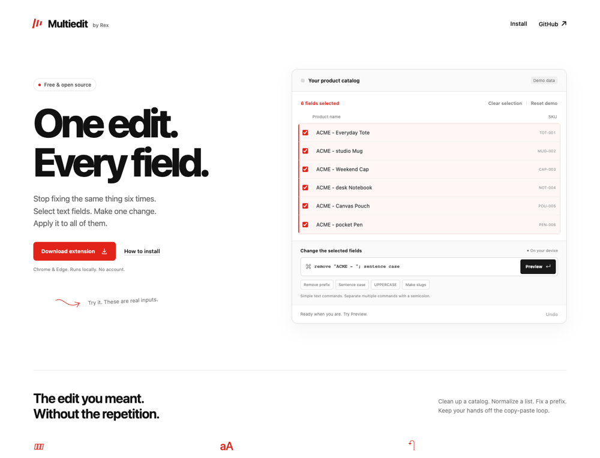

<div align="center">

# Multiedit

### One edit. Every field.

Select several text fields on a webpage. Transform them together. Preview, apply, undo.

**[Try the interactive demo](https://chaseakub.github.io/multiedit/) · [Download the extension](https://github.com/chaseakub/multiedit/releases/latest/download/multiedit.zip) · [Commands](#commands)**

Built by **[Chase Kubala](https://github.com/chaseakub)**, from **[Replio](https://repliohq.com)** and **Rex**.

</div>



## A small tool for repeated edits

A supplier prefix appears in six product titles. Several fields need consistent casing. A list needs slugs or numbering. Multiedit lets you apply one transformation across the fields you choose, without copying each value into another app.

- Select individual text inputs and textareas, or select the supported fields currently visible.
- Preview each original value next to its proposed replacement.
- Combine simple commands: `remove prefix "ACME - "; sentence case`.
- Apply the edit and use the website's own Save button when needed.
- Undo the latest edit while the panel remains open. Values changed since the edit are skipped.

**No account. No API key. No model. No analytics.** Commands run locally and use a fixed grammar. This is not an arbitrary natural-language assistant.

## Install in Chrome or Edge

1. [Download multiedit.zip](https://github.com/chaseakub/multiedit/releases/latest/download/multiedit.zip) and unzip it.
2. Open `chrome://extensions` or `edge://extensions`.
3. Turn on **Developer mode**, choose **Load unpacked**, and select the extracted `multiedit` folder that contains `manifest.json`.
4. Pin Multiedit. Open a regular webpage with editable text fields, then click the extension or press **Alt+Shift+E** (Option+Shift+E on Mac).
5. Select fields, choose a command, preview, and apply.

The first release is an unpacked extension, not a Chrome Web Store listing. If the shortcut is already taken, configure it at `chrome://extensions/shortcuts`.

**Try without installing:** the [interactive demo](https://chaseakub.github.io/multiedit/) uses the same transformation engine. Its catalog is explicitly demonstration data.

## Commands

Text arguments must be quoted. Matching is literal and case-sensitive. Commands are case-insensitive.

| Command | Effect |
| --- | --- |
| `remove "ACME - "` | Remove every occurrence of that exact text |
| `remove prefix "ACME - "` | Remove it only from the start |
| `remove suffix " (draft)"` | Remove it only from the end |
| `replace "blue" with "navy"` | Replace every literal match |
| `sentence case` | Capitalize sentence starts, preserving model tokens and interior acronyms |
| `title case` | Capitalize words, preserving model tokens and acronyms |
| `uppercase` / `lowercase` | Convert letter case |
| `trim` | Remove edge whitespace and collapse internal whitespace |
| `slug` | Make lowercase, hyphen-separated text; retain Unicode letters and numbers |
| `prefix "New: "` / `suffix " (review)"` | Add literal text |
| `number from 1` | Number fields in selection order |

Chain operations with `;` or `then`:

```text
remove prefix "ACME - "; sentence case; trim
replace " / " with "-"; lowercase
prefix "Release: "; number from 1
```

Sentence case conservatively keeps interior all-capital words as possible acronyms. It will not turn an entirely uppercase paragraph into ordinary prose. Case conversion, slugging and other explicit operations may change identifiers; review the preview before applying.

## What it supports

- Visible, enabled, writable text, search, email, URL and telephone inputs, plus textareas.
- Normal input/change events, including a tested React 19 controlled-form fixture.
- Protection against applying a preview after its selected values changed.
- Conflict-aware undo that avoids overwriting newer field values.

This is an early release. It does **not** support rich-text/contenteditable editors, dropdowns, iframe contents, shadow-root fields, background tabs, or every website. Browser internal pages and the Chrome Web Store block extension injection. Password and common sensitive fields are excluded on a best-effort basis.

**A site may autosave when inputs change.** Multiedit never clicks Submit or Save, but its input events can trigger the site's own behavior. Undo is another field edit, not a guaranteed reversal of server-side effects. Always review the page and its saved result. Closing the panel discards its undo history.

## Privacy and permissions

Only `activeTab` and `scripting` are requested. Access starts when you invoke the extension. No broad persistent host permissions, storage, remote requests or telemetry are included. See [PRIVACY.md](PRIVACY.md).

## Build and contribute

Node.js 24+:

```sh
npm ci
npm run dev
```

Checks and packages:

```sh
npm test
npm run lint
npm run build
npx playwright install chromium
npm run test:browser
```

`npm run build` produces the site in `dist/`, an unpacked extension in `dist-extension/`, and the downloadable `dist/multiedit.zip`.

| Directory | Purpose |
| --- | --- |
| `src/core.js` | Shared local transformation engine |
| `src/demo.js` | Interactive public demo |
| `extension/` | Selection, preview, input application and undo |
| `tests/` | Command and browser regression tests |

Useful contributions: small predictable transformations, keyboard improvements, minimal reproducible compatibility fixes, and better installation instructions. [Contribution guide](CONTRIBUTING.md).

## Why this exists

While exploring everyday interactions for Rex, Replio's agent, we wanted a smaller tool people could use on its own. Multiedit is new standalone code. It does not include Replio's private customer workflows or require a Replio subscription.

If you use it in your workflow, show us what you're editing. Use invented data in public screenshots and bug reports.

MIT licensed. Copyright 2026 Chase Kubala.
